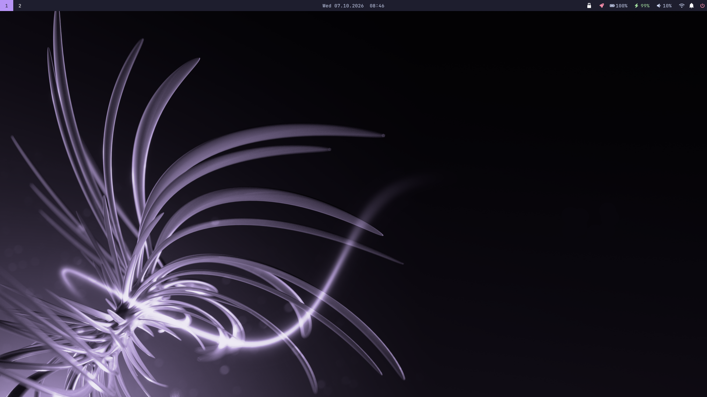
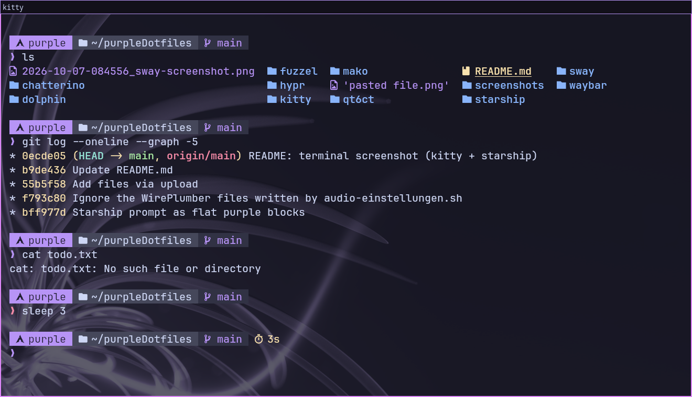
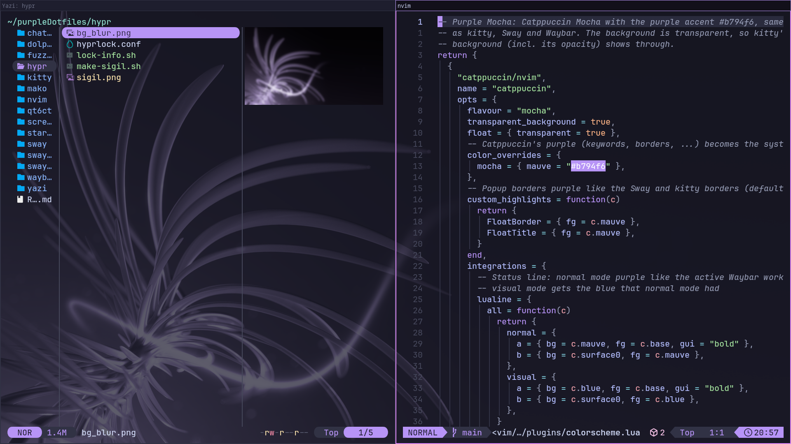

# purpleDotfiles
## My T580 config.

The Dotfiles include:
- Sway (incl. the wallpaper `sway/wallpaper.png`)
- Waybar (incl. Bluetooth, audio output, WLAN, power profile and notification history menus)
- Hyprlock
- Fuzzel
- Mako (notifications)
- qt6ct + KDE color scheme (purple theme for Qt apps like Dolphin)
- Chatterino theme
- Kitty (terminal, same colors)
- Starship (shell prompt as flat purple blocks)
- swayimg (image viewer, same colors)
- SwayOSD (small on-screen display with icon for volume and brightness)
- Yazi (file manager in the same colors; Enter goes into folders instead of opening them in $EDITOR, nvim when $EDITOR is unset)
- Neovim (LazyVim with Catppuccin Mocha, purple accent, transparent background like kitty)

### Setup
On a fresh, minimal Arch Linux, as your normal user with sudo:
```sh
sudo pacman -S --needed git
git clone https://github.com/PurpleCloudUwU/purpleDotfiles ~/purpleDotfiles
~/purpleDotfiles/install.sh
```
The script installs the needed packages (official repos, plus `sway-screenshot`
from the AUR via paru), symlinks the configs into place (old ones are moved to
`~/dotfiles-backup-<date>/`), applies the additional settings below and enables
NetworkManager, Bluetooth, TLP and the ly login manager. Then reboot and choose
Sway in ly. Options: `--copy` (copy instead of symlink), `--no-packages`,
`--no-services`, `--help`.

#### Manual setup
The configs are symlinked into place, so this repo is the live config
(move existing folders out of the way first):
```sh
git clone https://github.com/PurpleCloudUwU/purpleDotfiles ~/purpleDotfiles
for d in sway waybar hypr fuzzel mako qt6ct kitty swayimg swayosd yazi nvim; do ln -s ~/purpleDotfiles/$d ~/.config/$d; done
ln -s ~/purpleDotfiles/dolphin/PurpleMocha.colors ~/.local/share/color-schemes/
ln -s ~/purpleDotfiles/chatterino/PurpleMocha.json ~/.local/share/chatterino/Themes/
ln -s ~/purpleDotfiles/starship/starship.toml ~/.config/starship.toml
~/purpleDotfiles/hypr/make-sigil.sh   # creates hypr/sigil.png (ignored by git)
```

### Where the files go
The config folders (`sway`, `waybar`, `hypr`, `fuzzel`, `mako`, `qt6ct`, `kitty`, `swayimg`, `swayosd`, `yazi`, `nvim`) go to `~/.config/` (e.g. `waybar/` -> `~/.config/waybar/`); `screenshots/` is only for this README. Exceptions:

| File | Destination |
|---|---|
| `dolphin/PurpleMocha.colors` | `~/.local/share/color-schemes/` |
| `chatterino/PurpleMocha.json` | `~/.local/share/chatterino/Themes/` |
| `starship/starship.toml` | `~/.config/starship.toml` |

Additional settings (`install.sh` does all of these):
- Qt apps use qt6ct: add `export QT_QPA_PLATFORMTHEME=qt6ct` to `~/.bash_profile` (needs a re-login).
- Editor for yazi, git etc.: add `export EDITOR=nvim` and `export VISUAL=nvim` to `~/.bash_profile`.
- Starship and `ls` with icons: add `alias ls='eza --icons=auto'` and, at the end, `eval "$(starship init bash)"` to `~/.bashrc`.
- swayimg as default image viewer: `xdg-mime default swayimg.desktop $(grep -Po '(?<=^MimeType=).*' /usr/share/applications/swayimg.desktop | tr ';' ' ')`
- kew as default music player. kew is a terminal app, so a local copy of its desktop entry starts it in its own kitty window (otherwise xdg-open, yazi and browsers run it invisibly):
  ```sh
  sed -e 's|^Exec=kew play %F$|Exec=kitty --class kew -e kew play %F|' -e 's|^Terminal=true$|Terminal=false|' \
      -e 's|^MimeType=.*|&audio/x-vorbis+ogg;audio/x-opus+ogg;|' \
      /usr/share/applications/kew.desktop > ~/.local/share/applications/kew.desktop
  xdg-mime default kew.desktop audio/mpeg audio/flac audio/x-flac audio/wav audio/x-wav audio/mp4 audio/x-m4a audio/ogg audio/opus audio/webm audio/x-vorbis+ogg audio/x-opus+ogg
  ```
- Dolphin as default for folders (kew also claims folders and would otherwise be picked): `xdg-mime default org.kde.dolphin.desktop inode/directory`
- Dolphin: in `~/.config/dolphinrc` set `ColorScheme=PurpleMocha` under `[UiSettings]`.
- Chatterino: select `PurpleMocha` as theme in the settings.
- `hypr/sigil.png` is generated per machine with `hypr/make-sigil.sh`.
- The Waybar clock is German (weekdays, week starts on Monday): remove the `#` before `de_DE.UTF-8 UTF-8` in `/etc/locale.gen` and run `sudo locale-gen`. Without this locale Waybar hides the clock.

### Terminal
Kitty with the starship prompt:



### Yazi and Neovim
Yazi (left) and Neovim with LazyVim (right) in the same colors:


